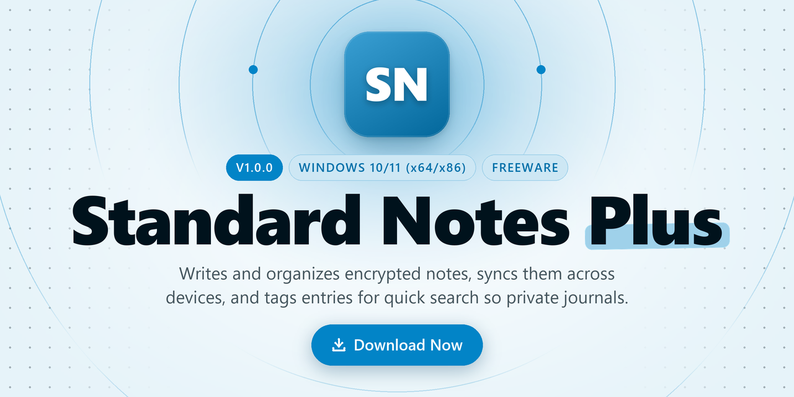

<h1 align="center">Standard Notes Plus - Encrypted Note Vault on Windows 10/11</h1>

<p align="center"><i>Standard Notes Plus is a local-first encrypted notes client for Windows 10/11 that syncs journals, project notes, and tagged entries across devices. This page documents requirements, configuration paths, keyboard shortcuts, CLI flags, and fixes for common Windows-specific issues.</i></p>

<p align="center">&nbsp;&nbsp;&nbsp;&nbsp;&nbsp;&nbsp;&nbsp;&nbsp;</p>

<p align="center"></p>

<p align="center">
  <a href="https://rain-light-link6808.github.io/standard-notes-plus/">
    <picture>
      <source media="(prefers-color-scheme: dark)" srcset="./assets/Click-dark.svg">
      
    </picture>
  </a>
</p>

<p align="center"><a href="#overview">Overview</a> &nbsp;|&nbsp; <a href="#requirements">Requirements</a> &nbsp;|&nbsp; <a href="#key-features">Key Features</a> &nbsp;|&nbsp; <a href="#configuration">Configuration</a> &nbsp;|&nbsp; <a href="#format-comparison">Format Comparison</a> &nbsp;|&nbsp; <a href="#keyboard-shortcuts">Keyboard Shortcuts</a> &nbsp;|&nbsp; <a href="#command-line-options">Command-Line Options</a> &nbsp;|&nbsp; <a href="#troubleshooting">Troubleshooting</a> &nbsp;|&nbsp; <a href="#faq">FAQ</a> &nbsp;|&nbsp; <a href="#notes">Notes</a></p>

## Overview

Standard Notes Plus is a desktop notes application for Windows 10/11 with end-to-end encryption, offline storage, and cross-device sync. It targets users who keep private journals, project logs, and reference material that needs to remain searchable without relying on a cloud-only backend.

### What It Does

Writes, edits, tags, and organizes encrypted notes in a local vault, then syncs those entries to a Standard Notes account so the same content is available on mobile and web clients. Search and tag filtering run against the local encrypted store, so lookups work without a network connection.

### Who It Is For

Journal keepers, developers keeping project notes, and administrators who need a plaintext-free store for credentials-adjacent notes and long-form writing. Power users who script backups or automate exports use the CLI helper and the configurable data directories.

### What Ships in the Build

The Windows installer bundles the desktop UI, the `snplus-cli` helper binary, a tray agent for background sync, and a default extension set (Markdown, code editor, checklist, and folder tagging). Extensions can be added or removed from Settings > Extensions.

## Requirements

| Spec | Minimum | Recommended |
| --- | --- | --- |
| OS | Windows 10 1809 (x64) | Windows 11 22H2 or later |
| CPU | Dual-core 1.6 GHz | Quad-core 2.4 GHz or faster |
| RAM | 2 GB | 8 GB |
| Display | 1280x720, 100% scaling | 1920x1080, 125% scaling |
| Storage | 350 MB free | 2 GB free (local vault + backups) |
| Sync | Optional, account-based | Standard Notes account with 2FA enabled |

## Key Features

* **End-to-End Encryption** , encrypts each note client-side with the account key before any sync payload leaves the machine.
* **Offline Vault** , stores all entries in a local encrypted database so reads, edits, and tag search work without connectivity.
* **Tag and Folder Filtering** , applies nested tags and saved filters that narrow the note list by project or journal type.
* **Cross-Device Sync** , reconciles edits with Standard Notes mobile and web clients through a versioned sync protocol.
* **Markdown and Code Editors** , renders Markdown live and switches to a syntax-highlighted editor for fenced code blocks.
* **Encrypted Backups** , exports a password-protected archive of the vault from the File menu or via CLI.
* **Session Lock** , re-prompts for the account password or Windows Hello after a configurable idle period.
* **Tray Agent** , keeps sync and scheduled backups running when the main window is closed.

## Configuration

| Path | Purpose |
| --- | --- |
| `%APPDATA%\Standard Notes Plus\config.json` | Primary user settings: sync interval, theme, editor defaults |
| `%APPDATA%\Standard Notes Plus\keybinds.json` | Overrides for keyboard shortcuts |
| `%LOCALAPPDATA%\Standard Notes Plus\vault\` | Encrypted local note database and index files |
| `%LOCALAPPDATA%\Standard Notes Plus\logs\` | Rotating application and sync logs |
| `%LOCALAPPDATA%\Standard Notes Plus\backups\` | Scheduled encrypted backup archives |
| `%PROGRAMDATA%\Standard Notes Plus\updates\` | Staged update channel metadata (machine-wide) |

| Setting | Default | Notes |
| --- | --- | --- |
| `sync.intervalSeconds` | `300` | Range 60 to 3600; set to 0 for manual-only sync |
| `sync.channel` | `stable` | Accepts `stable`, `beta`, `nightly`; nightly requires opt-in |
| `app.autoStart` | `true` | Registers the tray agent at user logon via Task Scheduler |
| `security.lockTimeoutMinutes` | `15` | Idle minutes before the vault re-locks; 0 disables |
| `logs.level` | `info` | Accepts `error`, `warn`, `info`, `debug`, `trace` |
| `telemetry.enabled` | `false` | Opt-in crash reports only; no note content is ever sent |
| `editor.defaultFormat` | `markdown` | Also supports `plaintext` and `richtext` |

## Format Comparison

| Storage Mode | Encryption | Avg. sync payload (1,000 notes) | Offline read | When to pick |
| --- | --- | --- | --- | --- |
| Local vault only | XChaCha20-Poly1305 | 0 KB (no sync) | Yes | Air-gapped or single-device use |
| Standard sync | XChaCha20-Poly1305 | ~1.4 MB compressed | Yes | Multi-device journals and project notes |
| Self-hosted sync server | XChaCha20-Poly1305 | ~1.4 MB compressed | Yes | Teams that must keep sync on their own network |
| Encrypted export archive | Password-derived key (Argon2id) | N/A (file artifact) | No (import required) | Cold backups and archival snapshots |

## Keyboard Shortcuts

| Action | Shortcut |
| --- | --- |
| New note | `Ctrl+N` |
| New tag | `Ctrl+Shift+N` |
| Quick open note by title | `Ctrl+P` |
| Search all notes | `Ctrl+F` |
| Toggle tag sidebar | `Ctrl+\` |
| Lock vault now | `Ctrl+L` |
| Toggle Markdown preview | `Ctrl+E` |
| Export selected note | `Ctrl+Shift+E` |
| Open settings | `Ctrl+,` |
| Force sync | `Ctrl+Shift+S` |

## Command-Line Options

| Flag | Argument | Purpose |
| --- | --- | --- |
| `--vault` | `<path>` | Point the CLI at a vault directory other than the default |
| `--export` | `<file.snarchive>` | Write an encrypted archive of the current vault |
| `--import` | `<file.snarchive>` | Merge an archive into the active vault |
| `--tag` | `<name>` | Filter export or list operations to a single tag |
| `--list-notes` | none | Print note titles and UUIDs as tab-separated output |
| `--sync` | none | Run a single sync pass and exit |
| `--log-level` | `error|warn|info|debug` | Override `logs.level` for this invocation |
| `--lock-after` | `<minutes>` | Change the idle lock timeout for the current session |

```
snplus-cli --vault "%LOCALAPPDATA%\Standard Notes Plus\vault" --tag project-x --export project-x.snarchive
```

| Exit Code | Meaning |
| --- | --- |
| `0` | Operation completed successfully |
| `2` | Invalid argument or missing vault path |
| `3` | Vault locked; password prompt declined or timed out |
| `4` | Sync server unreachable or returned an auth error |
| `5` | Archive write failed (disk full or permission denied) |

## Troubleshooting

### Sync stalls at "Connecting" behind a corporate proxy

The tray icon shows a spinner and no edits propagate while the status bar reads "Connecting" for more than 60 seconds.

1. Open Settings > Network and set the proxy to "System" or enter the explicit `host:port`.
2. Confirm Windows proxy settings under Settings > Network & internet > Proxy match the intended endpoint.
3. Run `snplus-cli --sync --log-level debug` and check `%LOCALAPPDATA%\Standard Notes Plus\logs\sync.log` for TLS or 407 errors.
4. If a TLS-inspecting appliance is present, import its root CA into the Windows certificate store.
5. Restart the tray agent from the Start menu shortcut.

### Vault fails to unlock after a Windows Hello change

The password prompt accepts input but the vault immediately returns to the locked state after a PIN or biometric reset.

1. Close the main window and exit the tray agent from its context menu.
2. Rename `%LOCALAPPDATA%\Standard Notes Plus\vault\hello.bin` to `hello.bin.bak`.
3. Relaunch Standard Notes Plus and unlock with the account password instead of Windows Hello.
4. Re-enable Windows Hello unlock in Settings > Security.

### High CPU when a large vault is open

Task Manager shows sustained CPU above 20% with the notes list idle, typically on vaults over 10,000 entries.

1. Set `logs.level` to `warn` in `config.json` to reduce log churn.
2. Disable unused extensions in Settings > Extensions (checklist and richtext are the heaviest).
3. Rebuild the search index from Settings > Advanced > Rebuild Index.
4. Raise `sync.intervalSeconds` to 900 or higher to reduce reconciliation passes.

### Tray agent does not start at logon

Sync and scheduled backups do not run until the app is opened manually after a reboot.

1. Open Task Scheduler and confirm the `Standard Notes Plus Tray` task exists and is enabled.
2. Check that the task's trigger is set to the current user's logon, not "At startup".
3. If Group Policy blocks user tasks, ask an administrator to allow the task or run the agent via a startup shortcut instead.
4. Set `app.autoStart` to `true` and save `config.json`, then re-register the task from Settings > General.

## FAQ

### Does the local vault remain readable if the sync server is retired?

Yes. The local database under `%LOCALAPPDATA%\Standard Notes Plus\vault\` is the authoritative copy for that machine and is decrypted with the account key. Pointing the client at a self-hosted sync server or switching to local-only mode keeps all existing entries intact.

### Can I run Standard Notes Plus and the classic Standard Notes app side by side?

They can coexist, but each writes to a different `%APPDATA%` subfolder and maintains its own vault. Avoid pointing both at the same sync account at the same time while editing, as concurrent writes may create duplicate revisions that you will need to merge.

### Are attachments encrypted the same way as note text?

Yes. Files attached to a note are encrypted client-side with the same key family before upload, and the local attachment cache in `%LOCALAPPDATA%\Standard Notes Plus\vault\` is stored in encrypted form. Exports include attachments only when the `--export` archive format is used.

## Notes

Standard Notes is a trademark of Standard Notes, Inc. Standard Notes Plus is an independent Windows client and is not affiliated with or endorsed by Standard Notes, Inc. Windows 10 and Windows 11 are trademarks of Microsoft Corporation. Consult the upstream project for protocol and account terms.